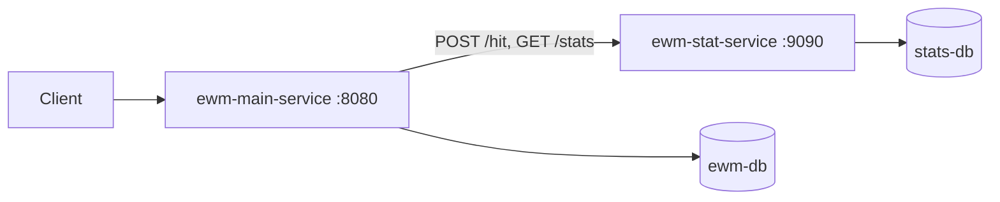

# Explore With Me

> Microservice-based event platform: publishing events, participation requests, moderation and view statistics.


[](https://github.com/pochette/explore-with-me/actions/workflows/api-tests.yml)

[Русский](README.md) · **English**

## About

A backend where users publish events and gather participants. The system consists of two independent services, each with its own database.

- **Main service** — users, categories, events, participation requests and compilations. The API has three access levels: public, private (user) and admin.
- **Statistics service** — records hits to public endpoints and counts event views, including unique views by IP.

**Key decisions:**

- **Separation of concerns.** Views are not stored in the main service; it fetches them from the statistics service through a dedicated HTTP client, `ewm-stats-client`.
- **Event lifecycle.** States `PENDING → PUBLISHED / CANCELED` and moderation rules: the event date must be at least 2 hours after creation, and at least 1 hour ahead when published by an admin. The rule is implemented as a custom validation annotation.
- **Requests with a participant limit.** The participant limit is enforced, requests can be confirmed or rejected in bulk, and rule violations return 409.
- **Dynamic search.** Public and admin search filters are built with JPA Specifications (Criteria API).
- **Controlled schema.** Liquibase migrations for both databases, multi-stage Dockerfiles, four containers started with one command.
- **Code quality.** The `check` Maven profile runs Checkstyle and SpotBugs; GitHub Actions runs Postman API tests on every pull request.

## Tech stack

| Area | Technologies |
| --- | --- |
| Language and framework | Java 21, Spring Boot 3.3 (Web, Data JPA, Validation, Actuator) |
| Data | PostgreSQL 17, Hibernate, Liquibase |
| Service communication | REST, custom statistics HTTP client |
| Quality | Checkstyle, SpotBugs, Postman, GitHub Actions |
| Build and run | Maven (multi-module), Docker, Docker Compose |

## Architecture



```text
explore-with-me
├── ewm-main-service/   # main service: controller (public/private/admin) → service → repository
├── ewm-stat-service/   # statistics service
└── ewm-stats-client/   # shared module: DTOs and statistics HTTP client
```

## Quick start

Requires Docker Desktop and free ports 8080 and 9090.

```bash
docker compose up --build
```

- Main service: http://localhost:8080
- Statistics service: http://localhost:9090

Stop with `docker compose down`; `-v` removes the volumes so migrations run again on the next start.

<details>
<summary><b>Build without Docker</b></summary>

```bash
mvn clean package -DskipTests        # all modules
mvn -pl ewm-main-service -am package # main service only
mvn -Pcheck install                  # with Checkstyle and SpotBugs
```

Environment variables: `SPRING_DATASOURCE_URL`, `POSTGRES_USER`, `POSTGRES_PASSWORD`, `STATS_SERVER_URL`.

</details>

## API

OpenAPI specs are in the repository root: [main service](ewm-main-service-spec.json), [statistics](ewm-stats-service-spec.json).

| Level | Endpoints |
| --- | --- |
| Public | `GET /events`, `GET /events/{id}`, `GET /categories[/{catId}]`, `GET /compilations[/{compId}]` |
| Private | `/users/{userId}/events` — CRUD for own events and their requests; `/users/{userId}/requests` — participation requests and cancellation |
| Admin | `/admin/users`, `/admin/categories`, `/admin/events` (moderation), `/admin/compilations` |
| Statistics | `POST /hit`, `GET /stats?start=&end=&uris=&unique=` |

Public search returns only published events. It supports case-insensitive text search in annotation and description, filters, and sorting by date or view count.

Errors use a single format, `{status, reason, message, timestamp}`, with 400 / 404 / 409 / 500 statuses.

## Data storage

| Service | Entities |
| --- | --- |
| Main | `User`, `Category`, `Event`, `Location`, `Request`, `Compilation` |
| Statistics | `App`, `Hit` |

Event states: `PENDING`, `PUBLISHED`, `CANCELED`. Request states: `PENDING`, `CONFIRMED`, `REJECTED`, `CANCELED`.

## Testing

The API is verified by Postman collections in GitHub Actions ([workflow](.github/workflows/api-tests.yml)) on every pull request: both services start in Docker and automated tests check all endpoints.

## Author

**Andrew Burdak** — [GitHub](https://github.com/pochette) · [Telegram @burdak_aa](https://t.me/burdak_aa) · [burdak.andrew@gmail.com](mailto:burdak.andrew@gmail.com)
