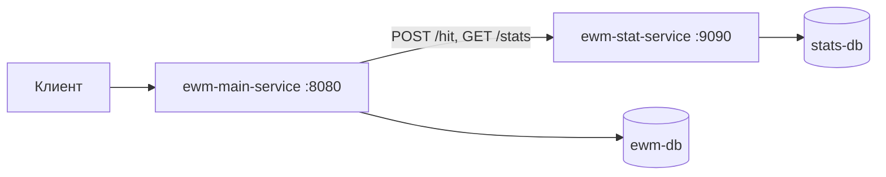

# Explore With Me

> Афиша событий на микросервисах: публикация мероприятий, заявки на участие, модерация и статистика просмотров.


[](https://github.com/pochette/explore-with-me/actions/workflows/api-tests.yml)

**Русский** · [English](README.en.md)

## О проекте

Бэкенд сервиса, где пользователи публикуют события и собирают участников. Система состоит из двух независимых сервисов, у каждого своя база данных.

- **Основной сервис** — пользователи, категории, события, заявки на участие и подборки. API разделён на три уровня доступа: публичный, пользовательский и администраторский.
- **Сервис статистики** — фиксирует обращения к публичным эндпоинтам и считает просмотры событий, в том числе уникальные по IP.

**Ключевые решения:**

- **Разделение ответственности.** Просмотры не хранятся в основном сервисе: он получает их из сервиса статистики через отдельный HTTP-клиент `ewm-stats-client`.
- **Жизненный цикл события.** Статусы `PENDING → PUBLISHED / CANCELED` и правила модерации: дата события — не раньше чем через 2 часа после создания, а при публикации администратором — не раньше чем через 1 час. Правило вынесено в собственную аннотацию валидации.
- **Заявки с ограничением мест.** Учёт лимита участников и пакетное подтверждение или отклонение заявок; нарушение правил возвращается со статусом 409.
- **Динамический поиск.** Фильтры публичного и админского поиска собираются через JPA Specification (Criteria API).
- **Схема под контролем.** Миграции Liquibase для обеих баз, multi-stage Dockerfile, четыре контейнера поднимаются одной командой.
- **Качество кода.** Maven-профиль `check` запускает Checkstyle и SpotBugs, CI на GitHub Actions прогоняет Postman-тесты API на каждый pull request.

## Стек

| Область | Технологии |
| --- | --- |
| Язык и фреймворк | Java 21, Spring Boot 3.3 (Web, Data JPA, Validation, Actuator) |
| Данные | PostgreSQL 17, Hibernate, Liquibase |
| Взаимодействие сервисов | REST, собственный HTTP-клиент статистики |
| Качество | Checkstyle, SpotBugs, Postman, GitHub Actions |
| Сборка и запуск | Maven (многомодульный проект), Docker, Docker Compose |

## Архитектура



```text
explore-with-me
├── ewm-main-service/   # основной сервис: controller (public/private/admin) → service → repository
├── ewm-stat-service/   # сервис статистики
└── ewm-stats-client/   # общий модуль: DTO и HTTP-клиент статистики
```

## Быстрый старт

Нужны Docker Desktop и свободные порты 8080 и 9090.

```bash
docker compose up --build
```

- Основной сервис: http://localhost:8080
- Сервис статистики: http://localhost:9090

Остановка: `docker compose down`. Флаг `-v` удаляет тома, и при следующем запуске миграции применятся заново.

<details>
<summary><b>Сборка без Docker</b></summary>

```bash
mvn clean package -DskipTests        # все модули
mvn -pl ewm-main-service -am package # только основной сервис
mvn -Pcheck install                  # с Checkstyle и SpotBugs
```

Переменные окружения: `SPRING_DATASOURCE_URL`, `POSTGRES_USER`, `POSTGRES_PASSWORD`, `STATS_SERVER_URL`.

</details>

## API

Спецификации OpenAPI лежат в корне репозитория: [основной сервис](ewm-main-service-spec.json), [статистика](ewm-stats-service-spec.json).

| Уровень | Эндпоинты |
| --- | --- |
| Public | `GET /events`, `GET /events/{id}`, `GET /categories[/{catId}]`, `GET /compilations[/{compId}]` |
| Private | `/users/{userId}/events` — CRUD своих событий и заявок к ним; `/users/{userId}/requests` — заявки на участие и их отмена |
| Admin | `/admin/users`, `/admin/categories`, `/admin/events` (модерация), `/admin/compilations` |
| Статистика | `POST /hit`, `GET /stats?start=&end=&uris=&unique=` |

Публичный поиск возвращает только опубликованные события. Он поддерживает текстовый поиск по аннотации и описанию без учёта регистра, фильтры и сортировку по дате или числу просмотров.

Ошибки возвращаются в едином формате `{status, reason, message, timestamp}` со статусами 400 / 404 / 409 / 500.

## Хранение данных

| Сервис | Сущности |
| --- | --- |
| Основной | `User`, `Category`, `Event`, `Location`, `Request`, `Compilation` |
| Статистика | `App`, `Hit` |

Статусы событий: `PENDING`, `PUBLISHED`, `CANCELED`. Статусы заявок: `PENDING`, `CONFIRMED`, `REJECTED`, `CANCELED`.

## Тестирование

API проверяется Postman-коллекциями в GitHub Actions ([workflow](.github/workflows/api-tests.yml)) на каждый pull request: оба сервиса поднимаются в Docker, и автотесты проверяют все эндпоинты.

## Автор

**Андрей Бурдак** — [GitHub](https://github.com/pochette) · [Telegram @burdak_aa](https://t.me/burdak_aa) · [burdak.andrew@gmail.com](mailto:burdak.andrew@gmail.com)
